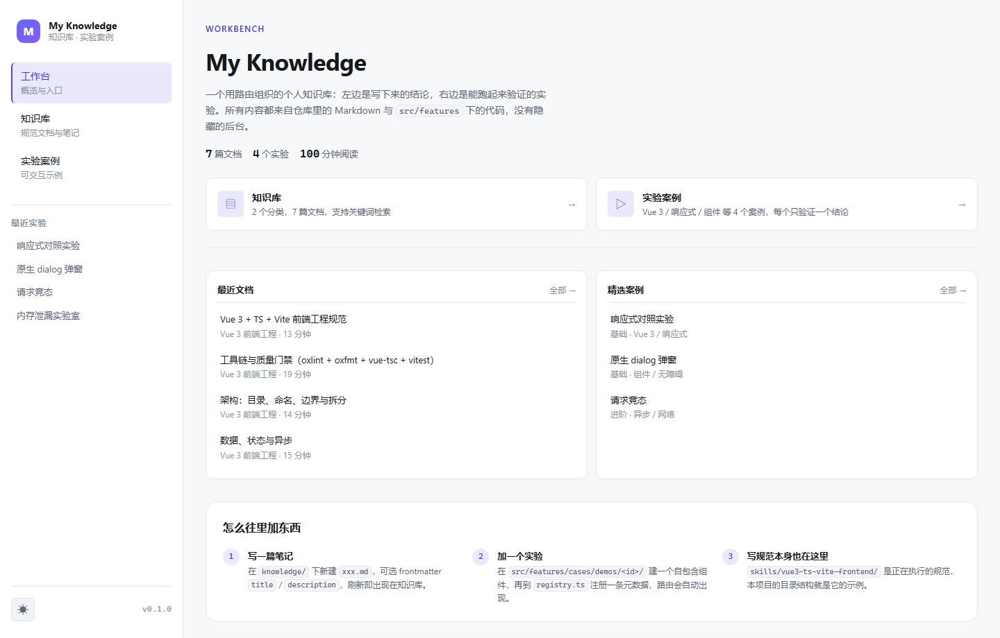
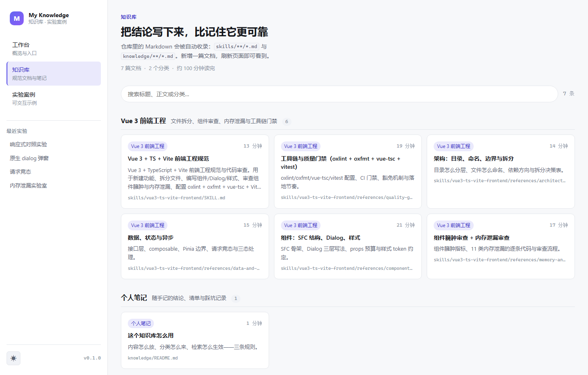
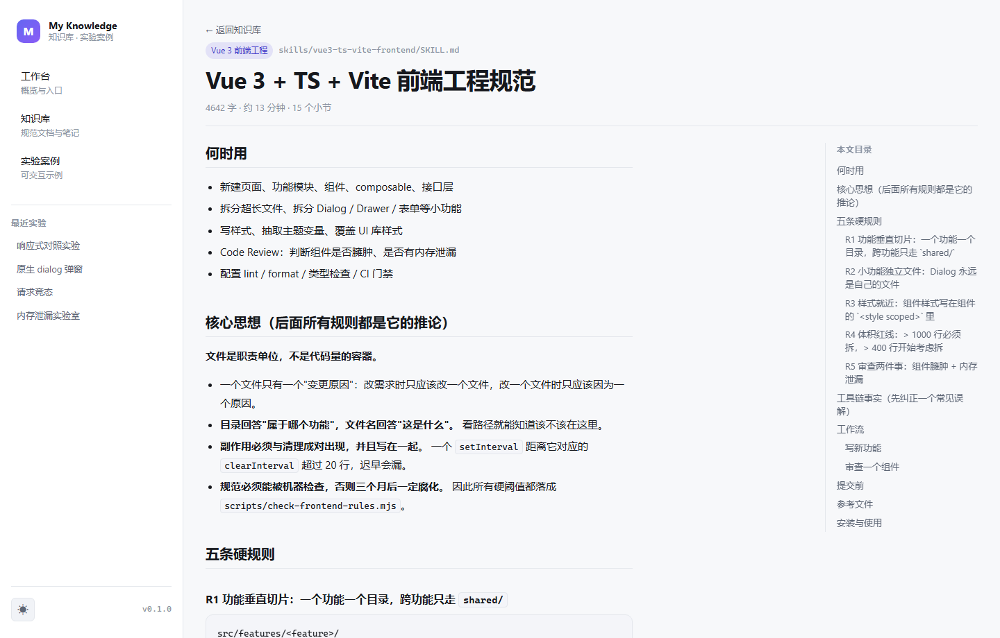

# My Knowledge

个人知识库 + 实验案例，Vue 3 + TypeScript + Vite，用路由划分模块。没有后端、没有数据库，内容全部来自仓库里的 Markdown 和 `src/features` 下的代码。

## 快速开始

```bash
npm install
npm run dev      # http://127.0.0.1:5180
```

构建与校验：

```bash
npm run build        # vue-tsc 类型检查 + vite 构建
npm run verify       # 类型检查 + 目录规范脚本（纯 JS/TS，任何机器可跑）
npm run verify:full  # 再加上 oxlint 与格式检查，CI 用
```

| 命令 | 做什么 |
| --- | --- |
| `npm run typecheck` | `vue-tsc --noEmit`，Vite 构建不做类型检查 |
| `npm run check:rules` | 行数、命名、目录边界、跨功能引用、副作用清理 |
| `npm run lint` / `npm run format` | oxlint / oxfmt |
| `npm run verify:full` | typecheck + lint + format:check + check:rules |

> **本机限制**：这台 Windows 机器的应用控制策略禁止加载未签名的原生模块，`oxlint` / `oxfmt` 的 `.node` 二进制会被拦截（报 `An Application Control policy has blocked this file`）。因此本地 `npm run lint` / `format` 会失败，`verify` 特意只保留纯 JS/TS 检查；换机器或在 CI 上跑 `verify:full`。

## 路由结构

| 路由 | 页面 | 说明 |
| --- | --- | --- |
| `/` | 工作台 | 统计、入口、最近文档、怎么加内容 |
| `/kb` | 知识库索引 | 分类分组 + 关键词检索 |
| `/kb/:id` | 文档详情 | Markdown 渲染 + 文内目录 |
| `/cases` | 案例索引 | 全部实验案例 |
| `/cases/:id` | 案例运行页 | 懒加载对应 demo 组件 |
| `*` | 404 | 兜底页 |

## 预览

| 工作台 | 知识库 |
| --- | --- |
|  |  |

| 文档详情 | 案例列表 |
| --- | --- |
|  |  |

## 目录

```
src/
  app/                     装配层：入口、路由、布局、全局样式
    router/index.ts        汇总各 feature 的 routes
    layouts/AppShell.vue   侧栏 + 内容区
    styles/                reset / tokens / vendor / utilities
    views/                 跨模块组合出来的页面（Home、404）
  shared/                  跨功能复用，禁止反向依赖 features
    ui/                    MarkdownBody、EmptyState、ThemeToggle
    utils/markdown.ts      零依赖 Markdown 渲染器
    composables/useTheme.ts
  features/
    knowledge/             知识库：types / data / routes / views / components
    cases/                 案例：registry / routes / views / components / demos
      demos/reactivity/    每个案例一个自包含目录
```

依赖方向单向：`app → features → shared`。两个 feature 之间不允许互相 import，跨模块的组合放到 `app/views`。

## 加一篇知识

1. 在 `knowledge/` 下新建 `xxx.md`（或放进 `skills/**`，也会被收录）；
2. 可选 frontmatter：

```md
---
title: 标题
description: 一句话摘要
---
```

3. 刷新页面即可，无需改代码。分类来自所在目录：`knowledge/` → 「个人笔记」，`skills/<技能名>/` → 该技能名。

## 加一个实验案例

1. 建目录 `src/features/cases/demos/<id>/`，写一个自包含的 `XxxDemo.vue`（只依赖 vue / vue-router / shared）；
2. 在 `src/features/cases/registry.ts` 增加一条元数据，`loader` 用动态 import；
3. 路由 `/cases/<id>` 自动可用，案例索引页也会出现新卡片。

## 约定

工程规范见 [`skills/vue3-ts-vite-frontend/SKILL.md`](skills/vue3-ts-vite-frontend/SKILL.md)，本项目是它的一个示例：

- 一个功能一个目录，Dialog 等小功能独立成文件；
- 组件样式写在组件内的 `<style scoped>`，颜色/间距只用 token；
- 文件 400 行警告、1000 行必须拆；
- 副作用与清理成对出现，`scripts/check-frontend-rules.mjs` 会检查目录边界、命名、行数与未配对的副作用。
