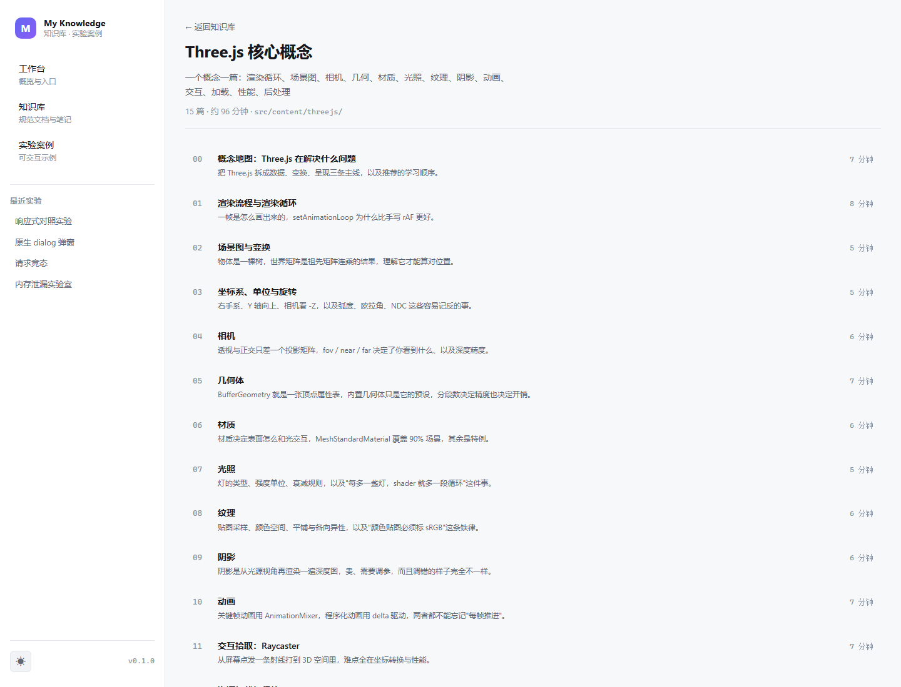
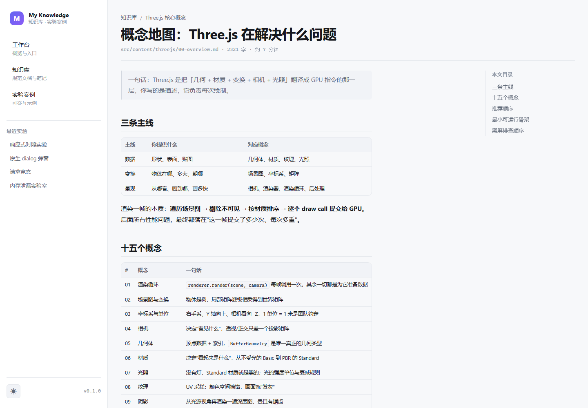

# My Knowledge

个人知识库 + 实验案例，Vue 3 + TypeScript + Vite，用路由划分模块。没有后端、没有数据库：知识库内容来自 `src/content/**/*.md`，案例来自 `src/features/cases/demos/`。

## 快速开始

```bash
npm install
npm run dev      # http://127.0.0.1:5180
```

构建与校验：

```bash
npm run build        # vue-tsc 类型检查 + vite 构建
npm run verify       # 类型检查 + 目录规范脚本（纯 JS/TS，任何机器可跑）
npm run verify:full  # 再加上 oxlint 与格式检查，CI 用
```

| 命令 | 做什么 |
| --- | --- |
| `npm run typecheck` | `vue-tsc --noEmit`，Vite 构建不做类型检查 |
| `npm run check:rules` | 行数、命名、目录边界、跨功能引用、副作用清理 |
| `npm run lint` / `npm run format` | oxlint / oxfmt |
| `npm run verify:full` | typecheck + lint + format:check + check:rules |

> **本机限制**：这台 Windows 机器的应用控制策略禁止加载未签名的原生模块，`oxlint` / `oxfmt` 的 `.node` 二进制会被拦截（报 `An Application Control policy has blocked this file`）。因此本地 `npm run lint` / `format` 会失败，`verify` 特意只保留纯 JS/TS 检查；换机器或在 CI 上跑 `verify:full`。

## 路由结构

| 路由 | 页面 | 说明 |
| --- | --- | --- |
| `/` | 工作台 | 统计、入口、最近文档、怎么加内容 |
| `/kb` | 知识库总览 | 合集卡片 + 关键词检索 |
| `/kb/:collection` | 合集页 | 该合集全部文档，按顺序列出 |
| `/kb/:collection/:slug` | 文档详情 | Markdown 渲染 + 文内目录 + 上一篇/下一篇 |
| `/cases` | 案例索引 | 全部实验案例 |
| `/cases/:id` | 案例运行页 | 懒加载对应 demo 组件 |
| `*` | 404 | 兜底页 |

## 预览

| 工作台 | 知识库总览 |
| --- | --- |
|  |  |

| 合集页 | 文档详情 |
| --- | --- |
|  |  |

| 案例列表 |
| --- |
|  |

## 目录

```
src/
  content/                    站点内容层：只有 Markdown 与元数据，不放代码
    <collection>/
      _meta.json              合集标题 / 摘要 / 排序
      <order>-<slug>.md       一篇文档一个文件，文件名数字前缀即顺序
  app/                        装配层：入口、路由、布局、全局样式
    router/index.ts           汇总各 feature 的 routes
    layouts/AppShell.vue      侧栏 + 内容区
    styles/                   reset / tokens / vendor / utilities
    views/                    跨模块组合出来的页面（Home、404）
  shared/                     跨功能复用，禁止反向依赖 features
    ui/                       MarkdownBody、EmptyState、ThemeToggle
    utils/markdown.ts         零依赖 Markdown 渲染器
    composables/useTheme.ts
  features/
    knowledge/                知识库：读取 src/content
      data/parse.ts           frontmatter / 标题 / 摘要 / 排序（纯函数）
      data/collections.ts     glob 读取 → 组装合集
      data/index.ts           对外 API
      routes.ts               /kb、/kb/:collection、/kb/:collection/:slug
      views/                  总览 / 合集 / 文档
      components/             CollectionCard、KnowledgeToc
    cases/                    案例：registry / routes / views / components / demos
      demos/reactivity/       每个案例一个自包含目录
```

依赖方向单向：`app → features → shared`。两个 feature 之间不允许互相 import，跨模块的组合放到 `app/views`。`src/content` 是数据层，只被 feature 读取，不 import 任何代码。

## 现有内容

| 合集 | 目录 | 篇数 | 说明 |
| --- | --- | --- | --- |
| Three.js 核心概念 | `src/content/threejs/` | 15 | 一个概念一篇，从渲染循环到后处理 |
| 个人笔记 | `src/content/notes/` | 1 | 这个知识库怎么用 |

`skills/` 下的技能文档（例如 `skills/vue3-ts-vite-frontend/`）是给 agent 读的规范，**不参与站点构建，也不出现在知识库里**。规范会随项目演进，可以作为 reference 单独维护。

## 加一篇知识

1. 放进已有合集：在 `src/content/threejs/` 下新建 `15-postprocessing-advanced.md`；
2. 或新建合集：建目录 `src/content/<collection>/`，加一个 `_meta.json`：

```json
{
  "title": "合集显示名",
  "summary": "一句话说明这个合集讲什么",
  "order": 3
}
```

3. frontmatter 可选，用于覆盖列表页的标题与摘要：

```md
---
title: 标题
description: 一句话摘要
order: 15
---
```

4. 刷新页面即可，无需改代码。排序规则：`frontmatter.order` → 文件名数字前缀 → 标题。

## 加一个实验案例

1. 建目录 `src/features/cases/demos/<id>/`，写一个自包含的 `XxxDemo.vue`（只依赖 vue / vue-router / shared）；
2. 在 `src/features/cases/registry.ts` 增加一条元数据，`loader` 用动态 import；
3. 路由 `/cases/<id>` 自动可用，案例索引页也会出现新卡片。

## 约定

工程规范见 [`skills/vue3-ts-vite-frontend/SKILL.md`](skills/vue3-ts-vite-frontend/SKILL.md)，本项目是它的一个示例：

- 一个功能一个目录，Dialog 等小功能独立成文件；
- 组件样式写在组件内的 `<style scoped>`，颜色/间距只用 token；
- 文件 400 行警告、1000 行必须拆；
- 副作用与清理成对出现，`scripts/check-frontend-rules.mjs` 会检查目录边界、命名、行数与未配对的副作用；
- 站点内容只来自 `src/content/`，`skills/` 不进构建：`import`/`import.meta.glob` 越出 `src/` 会被 `architecture/import-outside-src`、`architecture/glob-outside-src` 拦下。
